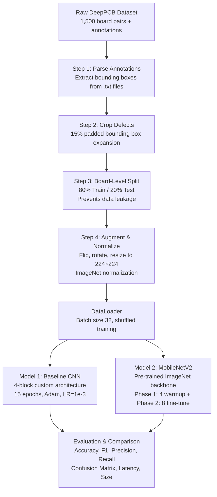

# PCB Defect Inspection Using Deep Learning — Comprehensive Project Guide

> **Prepared for Viva Examination — October 2026**

---

## Table of Contents

1. [Problem Statement](#1-problem-statement)
2. [Purpose & Motivation](#2-purpose--motivation)
3. [Dataset — DeepPCB Benchmark](#3-dataset--deeppcb-benchmark)
4. [Data Preprocessing Pipeline](#4-data-preprocessing-pipeline)
5. [CNN Fundamentals — Glossary of Technical Jargon](#5-cnn-fundamentals--glossary-of-technical-jargon)
6. [Model 1 — Custom Baseline CNN](#6-model-1--custom-baseline-cnn)
7. [Model 2 — MobileNetV2 (Transfer Learning)](#7-model-2--mobilenetv2-transfer-learning)
8. [Activation Functions — Formulas & Intuition](#8-activation-functions--formulas--intuition)
9. [Loss Function, Optimizer & Training Configuration](#9-loss-function-optimizer--training-configuration)
10. [Evaluation Metrics](#10-evaluation-metrics)
11. [Project Pipeline — End-to-End Flow](#11-project-pipeline--end-to-end-flow)

---

## 1. Problem Statement

Printed Circuit Boards (PCBs) are the foundational interconnect substrate in virtually all modern electronic devices — from smartphones to medical imaging equipment and aerospace flight computers. Contemporary PCB fabrication involves ultra-dense trace layouts with sub-millimeter copper traces, where even a microscopic structural defect can cause complete circuit failure or dangerous short circuits.

### The Industrial Quality-Control Bottleneck

| Current Method | Limitation |
|---|---|
| **Manual Visual Inspection** | Human inspectors examining boards under microscopes suffer cognitive fatigue, leading to a **defect escape rate of 15–30%** in high-volume lines. |
| **Traditional Automated Optical Inspection (AOI)** | Relies on rigid template matching and pixel-level subtraction. Hypersensitive to lighting variation, solder mask color shifts, and minor board warpage — causing **high false-positive alarm rates**. |

### Our Objective

> Build an **end-to-end deep-learning computer vision pipeline** that automatically classifies PCB surface defects into **6 manufacturing defect categories** with high accuracy, replacing brittle template-matching with learned visual feature representations.

---

## 2. Purpose & Motivation

- **Eliminate human error**: Automate fatigue-prone visual inspection with a consistent, tireless neural classifier.
- **Reduce false alarms**: Replace pixel-subtraction heuristics with learned features that are invariant to lighting and surface finish variation.
- **Enable real-time inline inspection**: Deploy lightweight models (like MobileNetV2) capable of classifying defect patches in milliseconds, suitable for integration into production conveyor inspection stations.
- **Benchmark custom vs. pre-trained architectures**: Compare a **from-scratch Baseline CNN** with a **Transfer-Learning MobileNetV2** to understand the trade-offs between model complexity, accuracy, and inference speed.

---

## 3. Dataset — DeepPCB Benchmark

**Source**: Peking University, Intelligent Hardware Laboratory  
**Link**: [github.com/tangsanli5201/DeepPCB](https://github.com/tangsanli5201/DeepPCB)

### 3.1 Dataset Composition

| Property | Detail |
|---|---|
| **Image Pairs** | 1,500 aligned optical image pairs (~640 × 640 px) |
| **Template Image** | Defect-free reference board (`*_temp.jpg`) |
| **Test Image** | Board with genuine manufacturing anomalies (`*_test.jpg`) |
| **Annotations** | Bounding box coordinates `[x1, y1, x2, y2, class_id]` per defect |
| **Total Cropped Patches** | **10,013** defect patches after preprocessing |
| **Train Set** | 8,046 patches (~80.35%) |
| **Test Set** | 1,967 patches (~19.65%) |

### 3.2 The Six Defect Classes

| Class ID | Defect Name | Description |
|:---:|---|---|
| 1 | **Open** | An unintended break or physical gap along a conductive copper trace, interrupting the circuit. |
| 2 | **Short** | An unintended conductive copper bridge spanning between two adjacent traces, creating a false connection. |
| 3 | **Mousebite** | An irregular edge erosion or notch bitten out of the copper boundary along a trace. |
| 4 | **Spur** | A sharp, unwanted copper flare or protrusion extending outward from a trace. |
| 5 | **Copper** (Spurious Copper) | An isolated island of excess un-etched copper sitting on the substrate where none should exist. |
| 6 | **Pin-hole** | A tiny void or hollow cavity inside an otherwise solid copper track or pad. |

---

## 4. Data Preprocessing Pipeline

The preprocessing pipeline transforms raw full-board images into clean, model-ready patches through four deliberate stages:

### Step 1 — Annotation Parsing

Each annotation text file contains lines formatted as:
```
x1  y1  x2  y2  class_id
```
These bounding box coordinates are parsed into tuples `(x1, y1, x2, y2, defect_type)` to locate each defect on its corresponding `*_test.jpg` board image.

### Step 2 — Contextual Bounding Box Expansion (15% Padding)

Raw annotation boxes tightly hug only the defective pixels. If cropped strictly at the box boundary, the model loses all surrounding structural context (e.g., neighboring traces, substrate edges). A **15% margin** is padded around every bounding box while clamping to image boundaries:

```
pad_w = int(box_width  × 0.15)
pad_h = int(box_height × 0.15)
```

This provides sufficient boundary context without incorporating neighboring irrelevant defects.

### Step 3 — Board-Level Train/Test Split (Preventing Data Leakage)

> [!CAUTION]
> **Data Leakage Risk**: If defect patches are split randomly, multiple patches from the *same physical board* (sharing identical lighting, background etching, and solder mask tint) can appear in both train and test sets. The model would "cheat" by memorizing board-specific artifacts rather than learning defect features.

**Solution**: The split is performed at the **annotation-file (board) level** using `sklearn.train_test_split` with an 80/20 ratio (`random_state=42`) *before* any cropping occurs. This guarantees every test patch comes from a board the model has never seen during training.

### Step 4 — Resizing, Augmentation & Normalization

| Operation | Train Set | Test Set |
|---|:---:|:---:|
| `Resize(224 × 224)` | ✅ | ✅ |
| `RandomHorizontalFlip(p=0.5)` | ✅ | ❌ |
| `RandomVerticalFlip(p=0.5)` | ✅ | ❌ |
| `RandomRotation(degrees=10)` | ✅ | ❌ |
| `ToTensor()` (scale 0–255 → 0.0–1.0) | ✅ | ✅ |
| `Normalize(mean, std)` — ImageNet stats | ✅ | ✅ |

**Why ImageNet normalization?** The MobileNetV2 backbone was pre-trained on ImageNet using `mean=[0.485, 0.456, 0.406]` and `std=[0.229, 0.224, 0.225]`. Applying the same normalization to the Baseline CNN ensures a fair comparison and channels the input values into a range the pre-trained features expect.

**Why data augmentation?** Random flips and rotation artificially increase the effective training set size, exposing the model to defect orientations not present in the original crops. This reduces overfitting, especially for smaller defect classes.

---

## 5. CNN Fundamentals — Glossary of Technical Jargon

This section defines every technical term used in the model architectures, explained in the context of PCB defect classification.

### Core Layer Types

| Term | What It Does | Simplified Meaning |
|---|---|---|
| **Convolution (Conv2d)** | Slides small learnable filters (kernels) across the image to detect local patterns like edges, corners, and texture transitions. | A "spotlight scanner" that searches every small patch for a specific visual pattern. |
| **Kernel / Filter** | A small matrix of learnable weights (e.g., 3×3) that performs element-wise multiplication and summation over image patches. | The "lens" or "stencil" the scanner uses — each filter detects one specific pattern (e.g., vertical edges). |
| **Feature Map / Channel** | The 2D output produced when one filter scans the entire image. Multiple filters produce multiple feature maps (channels). | Each feature map is like a transparent X-ray sheet highlighting where a specific pattern was detected in the image. |
| **Padding** | Adding rows/columns of zeros around the input border before convolution so the output retains the same spatial size. | A "safety border" that prevents the image from shrinking after each convolution. |
| **Stride** | The step size (in pixels) by which the filter moves across the image. Stride=1 moves one pixel at a time; stride=2 skips every other position. | How far the scanner jumps between scans — bigger stride = faster scanning but coarser coverage. |
| **Batch Normalization (BatchNorm2d)** | Normalizes the activations across a mini-batch to have zero mean and unit variance, then applies learnable scale/shift. | A "signal stabilizer" that keeps the numbers flowing through the network well-behaved, preventing training instability. |
| **Pooling (MaxPool2d)** | Downsamples spatial dimensions by taking the maximum value in each local window (e.g., 2×2). | A "summary operation" that shrinks the image by keeping only the strongest signal in every small neighborhood. |
| **Adaptive Average Pooling** | Automatically calculates the kernel size and stride needed to output a fixed spatial size, using averaging instead of max. | A flexible pooling that always outputs a fixed-size grid (e.g., 4×4) regardless of what size enters. |
| **Flatten** | Reshapes a 3D tensor (channels × height × width) into a 1D vector. | "Unrolling" the stack of feature maps into a single long list of numbers so a fully connected layer can process it. |
| **Fully Connected / Linear (nn.Linear)** | Every input neuron is connected to every output neuron via learned weights. Computes $y = Wx + b$. | A "decision layer" that weighs all features together to produce scores. |
| **Dropout** | During training, randomly zeroes out a fraction of neurons (e.g., 40%) on each forward pass. Disabled during inference. | Forces the network to learn redundant, robust representations instead of memorizing training samples. A regularization technique. |

### Key Concepts

| Term | Simplified Meaning |
|---|---|
| **Receptive Field** | The total area of the original input image that a single neuron in a deeper layer can "see" or be influenced by. Grows with each layer. |
| **Logits** | Raw, unnormalized output scores from the final linear layer — one score per class. Not yet probabilities. |
| **Softmax** | A function that converts logits into probabilities summing to 1.0, used to interpret model confidence. |
| **Inference** | Running a trained model on new, unseen data to get predictions (no weight updates happen). |
| **Epoch** | One complete pass through the entire training dataset. |
| **Batch Size** | The number of samples processed together before updating model weights. |
| **Learning Rate (LR)** | Controls how aggressively weights are updated — too high causes overshooting, too low causes slow convergence. |
| **Overfitting** | When the model memorizes training data instead of learning generalizable patterns, performing well on training but poorly on unseen test data. |
| **Regularization** | Techniques (Dropout, weight decay, augmentation) that prevent overfitting by discouraging the model from becoming overly complex. |
| **Transfer Learning** | Reusing a model pre-trained on a large dataset (ImageNet) and fine-tuning it on a smaller, domain-specific dataset (PCB defects). |
| **Fine-Tuning** | Unfreezing some or all pre-trained layers and training them with a small learning rate to adapt features to the new domain. |
| **Feature Extractor / Backbone** | The convolutional body of a CNN that extracts visual features. In transfer learning, this is the pre-trained part. |
| **Classifier Head** | The final fully connected layer(s) that take extracted features and output class predictions. Replaced when adapting to a new task. |
| **Freezing Layers** | Setting `requires_grad = False` on parameters so they are not updated during backpropagation, preserving pre-trained knowledge. |
| **Depthwise Separable Convolution** | A factored convolution used in MobileNetV2 that splits a standard convolution into a depthwise spatial filter and a 1×1 pointwise mixer, drastically reducing computation. |
| **Inverted Residual Block (Bottleneck)** | MobileNetV2's core building block: expands channels → depthwise convolution → compresses channels back, with a skip connection. |
| **Skip / Residual Connection** | A shortcut that adds the block's input directly to its output, enabling gradient flow through very deep networks and preventing vanishing gradients. |
| **Backpropagation** | The algorithm that computes how much each weight contributed to the error and updates them accordingly using gradient descent. |
| **Gradient Descent** | The optimization process that iteratively adjusts weights in the direction that minimizes the loss function. |

---

## 6. Model 1 — Custom Baseline CNN

A **4-block convolutional neural network** designed from scratch specifically for this 6-class PCB defect classification task.

### 6.1 Architecture Overview

```
INPUT: Normalized Defect Patch (3 × 224 × 224)
  │
  ▼
┌─────────────────────────────────────────────────────────────────────┐
│ BLOCK 1: Conv2d(3→32, k=3, p=1) → BatchNorm2d → ReLU → MaxPool2d │ → 32 × 112 × 112
└─────────────────────────────────────────────────────────────────────┘
  │
  ▼
┌──────────────────────────────────────────────────────────────────────┐
│ BLOCK 2: Conv2d(32→64, k=3, p=1) → BatchNorm2d → ReLU → MaxPool2d │ → 64 × 56 × 56
└──────────────────────────────────────────────────────────────────────┘
  │
  ▼
┌───────────────────────────────────────────────────────────────────────┐
│ BLOCK 3: Conv2d(64→128, k=3, p=1) → BatchNorm2d → ReLU → MaxPool2d │ → 128 × 28 × 28
└───────────────────────────────────────────────────────────────────────┘
  │
  ▼
┌────────────────────────────────────────────────────────────────────────┐
│ BLOCK 4: Conv2d(128→256, k=3, p=1) → BatchNorm2d → ReLU → MaxPool2d │ → 256 × 14 × 14
└────────────────────────────────────────────────────────────────────────┘
  │
  ▼
┌────────────────────────────────────────────────────────────────────────┐
│ SPATIAL POOLING: AdaptiveAvgPool2d((4, 4))                            │ → 256 × 4 × 4
└────────────────────────────────────────────────────────────────────────┘
  │
  ▼
┌────────────────────────────────────────────────────────────────────────┐
│ CLASSIFIER HEAD:                                                      │
│ Flatten(4096) → Linear(4096→256) → ReLU → Dropout(0.4) →             │
│ Linear(256→6)                                                         │ → 6 Logits
└────────────────────────────────────────────────────────────────────────┘
```

### 6.2 Layer-by-Layer Breakdown

Each convolutional block follows the sequence: **Conv2d → BatchNorm2d → ReLU → MaxPool2d**

#### Conv2d — Convolutional Layer
- **What**: Slides 3×3 learnable filters across the image to extract local structural features (edges, corners, texture).
- **PCB context**: Detects copper trace boundaries, gap edges, and anomalous copper shapes at various levels of abstraction.
- **Padding = 1**: Ensures the spatial dimensions are preserved after convolution (the output width/height equals the input before pooling).

#### BatchNorm2d — Batch Normalization
- **What**: Normalizes layer activations to zero mean and unit variance across each mini-batch.
- **Why**: Stabilizes gradient updates, prevents internal covariate shift, and allows using a higher learning rate (1e-3) without divergence.

#### ReLU — Rectified Linear Unit
- **What**: Applies $f(x) = \max(0, x)$, zeroing out all negative values.
- **Why**: Introduces non-linearity. Without it, stacking convolutions is equivalent to a single linear operation — the network could only learn straight-line decision boundaries and would fail to recognize curved traces, circular vias, and complex defect shapes.

#### MaxPool2d — Max Pooling
- **What**: In each 2×2 window, keeps only the maximum value, halving spatial dimensions.
- **Why**: (a) Reduces computation by 75% per block, (b) Retains the strongest defect activation signals while discarding flat, uninformative background.

### 6.3 Channel Progression — Hierarchical Feature Abstraction

| Block | Channels | Spatial Size | What It Learns |
|:---:|:---:|:---:|---|
| Input | 3 (RGB) | 224 × 224 | Raw pixel colors |
| Block 1 | 32 | 112 × 112 | Low-level: edges, lines, sharp corners |
| Block 2 | 64 | 56 × 56 | Mid-level: trace curvatures, T-junctions, surface textures |
| Block 3 | 128 | 28 × 28 | High-level: trace continuity, copper voids, structural shapes |
| Block 4 | 256 | 14 × 14 | Defect-specific: distinguishes open vs. short vs. mousebite vs. spur vs. copper vs. pin-hole |

> **Design principle**: As spatial resolution halves (fewer pixels), channel depth doubles (more feature detectors). This trades "where" information for "what" information — deeper layers have larger receptive fields and represent increasingly abstract, defect-specific concepts.

### 6.4 Adaptive Average Pooling — `AdaptiveAvgPool2d((4, 4))`

After Block 4, the tensor is 256 × 14 × 14. Instead of flattening directly (which would produce 50,176 values and require ~12.8M parameters in the next linear layer), adaptive average pooling compresses each feature map into a fixed 4 × 4 grid:

- **How**: Automatically computes the kernel size and stride needed to output exactly 4 × 4, regardless of input size.
- **Output**: 256 × 4 × 4 = **4,096** values.
- **Why average (not max)?**: At this depth, features are already detected. Averaging measures the *density* and *spatial extent* of defect activations in each region, providing a stable summary less susceptible to single-pixel noise spikes.

### 6.5 Classification Head

$$\text{Flatten}(4096) \xrightarrow{\text{Linear}} 256 \xrightarrow{\text{ReLU}} \text{Dropout}(0.4) \xrightarrow{\text{Linear}} 6 \text{ logits}$$

| Layer | Purpose |
|---|---|
| **Flatten** | Converts the 3D tensor (256 × 4 × 4) into a 1D vector of 4,096 values. |
| **Linear(4096 → 256)** | Non-linear bottleneck — compresses 4,096 features into 256 discriminative features. Prevents parameter explosion. |
| **ReLU** | Adds non-linearity in the classifier so it can model complex feature interactions. |
| **Dropout(p=0.4)** | Randomly deactivates 40% of neurons during training. Forces the network to learn redundant, robust defect cues rather than memorizing samples. A regularization technique. |
| **Linear(256 → 6)** | Final projection that outputs 6 raw logits — one unnormalized score per defect class. |

---

## 7. Model 2 — MobileNetV2 (Transfer Learning)

### 7.1 What Is MobileNetV2?

MobileNetV2 is a **lightweight, mobile-optimized** convolutional neural network architecture developed by Google (2018). It was pre-trained on the **ImageNet** dataset (1.2 million images, 1,000 classes), learning rich, general-purpose visual features: edges, textures, shapes, and object parts.

### 7.2 Why Transfer Learning?

Instead of training a deep CNN from scratch (which requires massive data and compute), **transfer learning** reuses the pre-trained MobileNetV2's feature backbone and adapts it to our PCB defect domain:

| Advantage | Explanation |
|---|---|
| **Pre-learned features** | Low-level features (edges, textures) learned from ImageNet transfer directly to PCB trace patterns. |
| **Faster convergence** | The model already "knows" how to detect visual patterns — only the final classifier needs significant training. |
| **Better generalization** | Features pre-trained on 1.2M diverse images are more robust than features trained on only ~8,000 PCB patches. |
| **Fewer training epochs** | Total: 4 warmup + 8 fine-tune = 12 epochs vs. 15 for Baseline. |

### 7.3 Key Architectural Concepts of MobileNetV2

#### Depthwise Separable Convolution
A standard convolution with $C_{in}$ input channels, $C_{out}$ output channels, and kernel $k$ has cost proportional to $C_{in} \times C_{out} \times k^2$. MobileNetV2 **factorizes** this into two cheaper steps:

1. **Depthwise Convolution**: Applies one $k \times k$ filter *per input channel* independently (spatial filtering). Cost: $C_{in} \times k^2$.
2. **Pointwise Convolution (1×1)**: A 1×1 convolution that mixes channel information. Cost: $C_{in} \times C_{out}$.

**Reduction**: This factorization reduces computation by roughly $\frac{1}{C_{out}} + \frac{1}{k^2}$ — about **8–9× cheaper** for a 3×3 kernel.

#### Inverted Residual Block (The Core Building Block)
Unlike traditional residual blocks that go *wide → narrow → wide*, MobileNetV2 uses an **inverted** structure:

```
Input (narrow)
  │
  ▼
1×1 Conv (Expand) ── channel expansion (e.g., ×6)
  │
  ▼
3×3 Depthwise Conv ── spatial filtering (lightweight)
  │
  ▼
1×1 Conv (Project) ── channel compression back to narrow
  │
  ▼
Output + Skip Connection (added back to Input)
```

- **Expand**: A 1×1 convolution expands the channels (e.g., from 64 to 384 with expansion factor 6).
- **Depthwise**: A 3×3 depthwise convolution performs spatial filtering in the expanded high-dimensional space.
- **Project**: A 1×1 convolution compresses channels back to a narrow representation.
- **Skip Connection**: The block's input is added directly to its output (only when input and output have the same shape), enabling gradient flow through deep networks.

#### Linear Bottleneck
The final 1×1 projection uses **no activation function** (linear). This is intentional — ReLU on narrow, low-dimensional representations would destroy information. The non-linearity is applied only in the high-dimensional expanded space where information can survive zeroing.

### 7.4 Our MobileNetV2 Configuration

#### Feature Backbone
- **Pre-trained weights**: `MobileNet_V2_Weights.DEFAULT` (ImageNet)
- **Frozen initially**: All feature layers have `requires_grad = False` — their weights are locked.

#### Custom Classifier Head
The original MobileNetV2 classifier (designed for 1,000 ImageNet classes) is **replaced** with:

```python
nn.Sequential(
    nn.Dropout(p=0.3),
    nn.Linear(in_features=1280, out_features=6)
)
```

- **1280**: The fixed output dimension of MobileNetV2's final feature layer.
- **Dropout(0.3)**: Lighter dropout than Baseline (0.3 vs. 0.4) because pre-trained features are already robust.
- **Linear(1280 → 6)**: Maps features to 6 PCB defect class logits.

### 7.5 Two-Phase Training Strategy

#### Phase 1 — Warmup (4 Epochs): Train Classifier Head Only
- **Frozen**: Entire feature backbone (`model.features`).
- **Trainable**: Only the custom classifier head.
- **Optimizer**: Adam on `model.classifier.parameters()` with LR = 1e-3.
- **Purpose**: Let the new random classifier head learn meaningful weights before touching the delicate pre-trained features.

#### Phase 2 — Fine-Tuning (8 Epochs): Unfreeze Top Layers
- **Unfrozen**: The **last 4 bottleneck blocks** of the feature backbone (`model.features[-4:]`).
- **Still Frozen**: The earlier layers that capture universal low-level features.
- **Differential Learning Rates**:
  - Unfrozen feature layers: LR = **1e-4** (gentle — don't destroy pre-trained knowledge)
  - Classifier head: LR = **3e-4** (moderate — continue adapting)
- **Purpose**: Adapt the high-level feature representations to PCB-specific patterns while preserving robust low-level features (edges, textures).

---

## 8. Activation Functions — Formulas & Intuition

### 8.1 ReLU (Rectified Linear Unit) — Used in Baseline CNN

$$f(x) = \max(0, x) = \begin{cases} x & \text{if } x > 0 \\ 0 & \text{if } x \leq 0 \end{cases}$$

| Property | Value |
|---|---|
| **Range** | $[0, +\infty)$ |
| **Derivative** | 1 if $x > 0$; 0 if $x < 0$; undefined at $x = 0$ (set to 0 in practice) |
| **Used in** | All convolutional blocks + classifier hidden layer of Baseline CNN |
| **Why** | Computationally trivial (just a threshold), prevents vanishing gradients for positive activations, introduces non-linearity enabling the network to learn complex curved decision boundaries |
| **Drawback** | **Dying ReLU problem** — neurons with persistently negative inputs output zero forever and stop learning. Mitigated by BatchNorm keeping activations centered around zero. |

### 8.2 ReLU6 — Used Internally in MobileNetV2

$$f(x) = \min(\max(0, x), 6) = \begin{cases} 0 & \text{if } x \leq 0 \\ x & \text{if } 0 < x < 6 \\ 6 & \text{if } x \geq 6 \end{cases}$$

| Property | Value |
|---|---|
| **Range** | $[0, 6]$ |
| **Used in** | All inverted residual blocks of MobileNetV2 (after expand and depthwise conv layers) |
| **Why** | Caps activations at 6 to improve numerical stability in low-precision (float16/int8) inference on mobile devices. Prevents runaway activations without adding computation. |

### 8.3 Softmax — Used Implicitly via CrossEntropyLoss

$$P(\text{class } i) = \frac{e^{z_i}}{\displaystyle\sum_{j=1}^{C} e^{z_j}}$$

where $z_i$ is the logit (raw score) for class $i$, and $C = 6$ is the number of classes.

| Property | Value |
|---|---|
| **Range** | $(0, 1)$ for each class, summing to exactly 1.0 |
| **Used in** | Implicitly inside `nn.CrossEntropyLoss` during training; explicitly at inference for probability interpretation |
| **Why** | Converts 6 raw logits into a valid probability distribution. The class with the highest probability is the model's prediction. |
| **Example** | Logits `[1.2, -0.8, 5.4, -2.1, 0.3, -1.0]` → Softmax → `[0.014, 0.002, 0.953, 0.001, 0.006, 0.002]` → Predicted: **Open** (Index 2, 95.3% confidence) |

### 8.4 Sigmoid — Related Concept (Not Directly Used)

$$\sigma(x) = \frac{1}{1 + e^{-x}}$$

| Property | Value |
|---|---|
| **Range** | $(0, 1)$ |
| **Note** | Common in binary classification. Not used in our 6-class pipeline, but Softmax is a multi-class generalization of Sigmoid. Mentioned here as evaluators often ask about the relationship. |

---

## 9. Loss Function, Optimizer & Training Configuration

### 9.1 Loss Function — Cross-Entropy Loss

$$\mathcal{L} = -\sum_{i=1}^{C} y_i \log(p_i)$$

where $y_i$ is the one-hot ground truth (1 for the correct class, 0 otherwise) and $p_i$ is the predicted probability (from softmax).

- In PyTorch, `nn.CrossEntropyLoss` combines `LogSoftmax` + `NLLLoss` internally, accepting raw logits directly (no need to apply softmax before it).
- **Why Cross-Entropy?** It heavily penalizes confident wrong predictions, pushing the model to assign high probability to the correct class.

### 9.2 Optimizer — Adam (Adaptive Moment Estimation)

$$\theta_{t+1} = \theta_t - \frac{\alpha \cdot \hat{m}_t}{\sqrt{\hat{v}_t} + \epsilon}$$

where $\hat{m}_t$ is the bias-corrected first moment (mean of gradients) and $\hat{v}_t$ is the bias-corrected second moment (variance of gradients).

| Hyperparameter | Value |
|---|---|
| **Learning Rate ($\alpha$)** | Baseline: 1e-3 ; MobileNetV2 Phase 1: 1e-3, Phase 2 features: 1e-4, Phase 2 head: 3e-4 |
| **Weight Decay** | 1e-4 (L2 regularization — penalizes large weights to prevent overfitting) |

- **Why Adam?** Combines the benefits of momentum (accelerates through flat loss surfaces) and RMSProp (adapts learning rate per-parameter). Converges faster than vanilla SGD on image classification tasks.

### 9.3 Training Configuration Summary

| Parameter | Baseline CNN | MobileNetV2 |
|---|:---:|:---:|
| **Total Epochs** | 15 | 12 (4 warmup + 8 fine-tune) |
| **Batch Size** | 32 | 32 |
| **Image Size** | 224 × 224 | 224 × 224 |
| **Dropout Rate** | 0.4 | 0.3 |
| **Optimizer** | Adam | Adam |
| **Weight Decay** | 1e-4 | 1e-4 |
| **Model Saving** | Best validation accuracy checkpoint | Best validation accuracy checkpoint |

---

## 10. Evaluation Metrics

Both models are evaluated on the held-out test set (1,967 patches from unseen boards) using:

### 10.1 Accuracy
$$\text{Accuracy} = \frac{\text{Number of correct predictions}}{\text{Total predictions}}$$

### 10.2 Precision (per class)
$$\text{Precision}_i = \frac{TP_i}{TP_i + FP_i}$$

*Of all patches the model predicted as class $i$, how many actually were class $i$?* High precision = few false alarms.

### 10.3 Recall (per class)
$$\text{Recall}_i = \frac{TP_i}{TP_i + FN_i}$$

*Of all actual class $i$ patches, how many did the model correctly identify?* High recall = few missed defects.

### 10.4 F1-Score (per class)
$$F_1 = 2 \times \frac{\text{Precision} \times \text{Recall}}{\text{Precision} + \text{Recall}}$$

The harmonic mean of Precision and Recall — balances both concerns. Especially important when classes are imbalanced.

### 10.5 Macro F1-Score
$$\text{Macro } F_1 = \frac{1}{C} \sum_{i=1}^{C} F_{1,i}$$

Average F1 across all 6 classes, treating each class equally regardless of size. This is the **primary comparison metric** between the two models.

### 10.6 Confusion Matrix
A 6×6 grid where cell $(i, j)$ shows how many patches of true class $i$ were predicted as class $j$. Diagonal = correct predictions; off-diagonal = errors. Generated as normalized heatmaps for visual inspection.

### 10.7 Inference Latency
Average time (in milliseconds) to classify a single defect patch. Measured after GPU warmup batches to exclude CUDA initialization overhead.

### 10.8 Model Size
File size of saved model weights (`.pth` file) in megabytes. Important for edge deployment feasibility.

---

## 11. Project Pipeline — End-to-End Flow



### File Structure

```
PCB-Defect-Inspection/
│
├── models/
│   ├── baseline_cnn.py          # Baseline CNN architecture definition
│   └── mobilenet_v2.py          # MobileNetV2 transfer learning wrapper
│
├── scripts/
│   ├── crop_defects.py          # Step 1: Parse annotations + crop + split
│   ├── dataset.py               # Step 2: Transforms, augmentation, DataLoaders
│   ├── train_baseline.py        # Step 3: Train baseline CNN (15 epochs)
│   ├── train_mobilenet.py       # Step 4: Train MobileNetV2 (two-phase)
│   └── evaluate_models.py       # Step 5: Benchmark both models side-by-side
│
├── data/                        # Generated: train/ and test/ with 6 class subdirs
├── raw_dataset/                 # Original DeepPCB dataset
└── reports/                     # Generated: confusion matrix plots
```

---

> [!TIP]
> **Quick Recall for Viva**: The project follows a clean 5-step pipeline:
> 1. **Crop** → 2. **Split & Augment** → 3. **Train Baseline** → 4. **Train MobileNet** → 5. **Evaluate & Compare**
>
> The two models represent a deliberate comparison: **custom simplicity** (Baseline CNN — learn everything from scratch) vs. **industrial efficiency** (MobileNetV2 — leverage ImageNet knowledge via transfer learning).

---

*End of guide. Good luck with your viva! 🎓*

